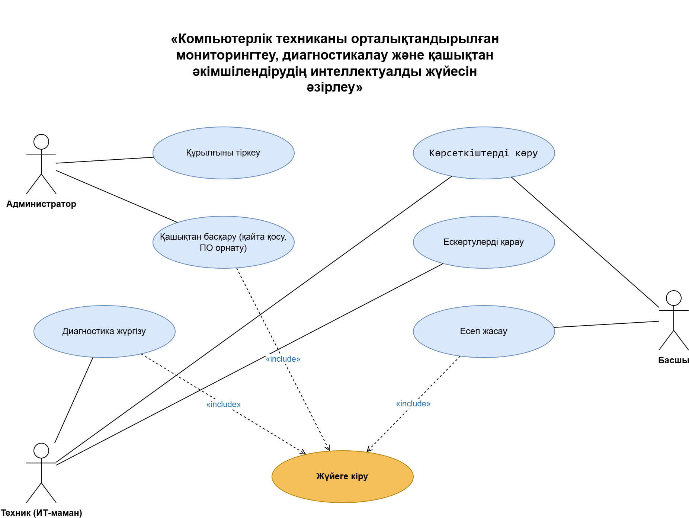
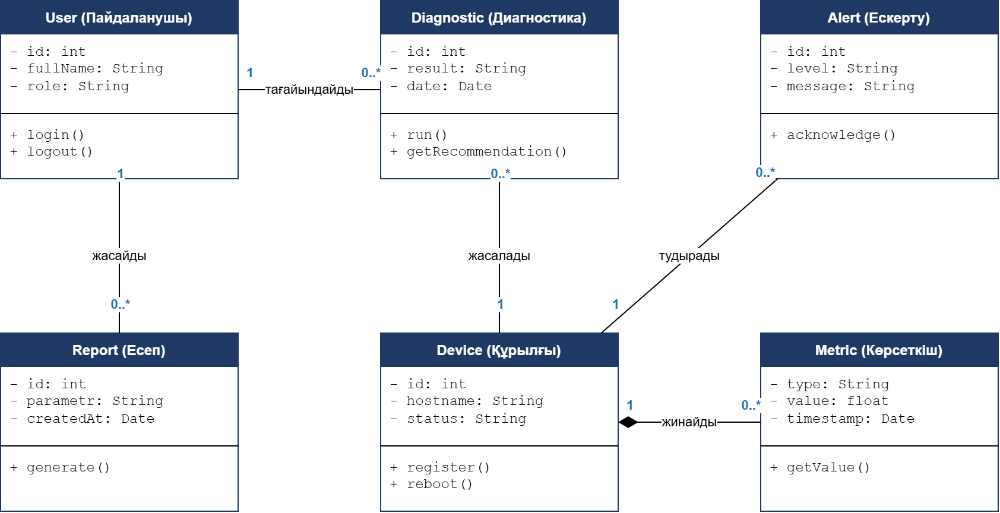
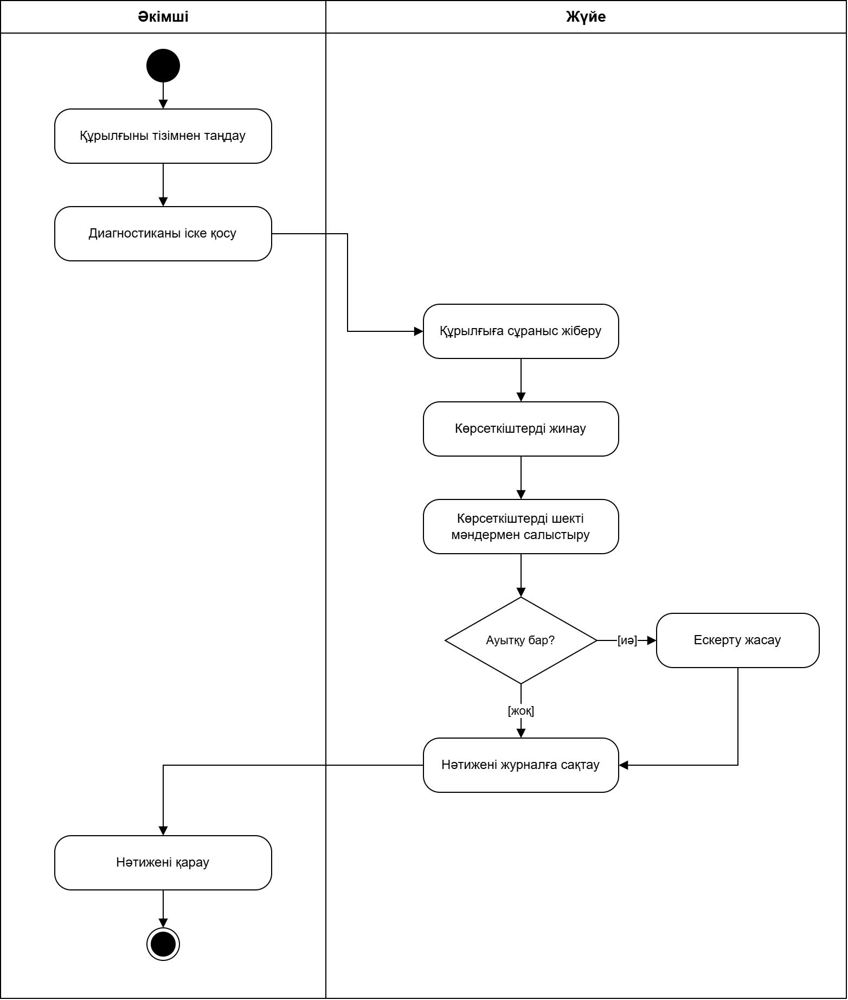
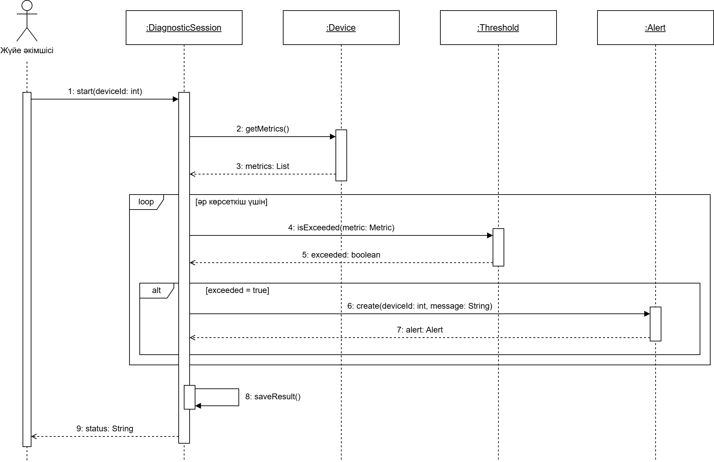

# Компьютерлік техниканы орталықтандырылған мониторингтеу, диагностикалау және қашықтан әкімшілендірудің интеллектуалды жүйесі

Автор: Исмагамбетов Алишер, ВТ(КИ)к-24-1а

## Мәселе

Ұйымда жүздеген компьютер болғанда, олардың жағдайын қолмен тексеру көп уақыт алады, ал ақаулық пайдаланушы шағымданғаннан кейін ғана анықталады. Жүйе барлық құрылғылардан көрсеткіштерді (CPU, RAM, диск, температура) бір орталыққа жинап, ауытқуды автоматты түрде табады және әкімшіге құрылғыға қашықтан қосылуға мүмкіндік береді. Ол IT-әкімшілерге және техникалық қолдау қызметіне арналған.

## Акторлар

- Жүйе әкімшісі
- Техникалық қолдау инженері
- Мониторинг агенті (құрылғыға орнатылған)

## Талаптар

### Функционалдық

(кейін толтырылады)

### Функционалдық емес

(кейін толтырылады)

## Диаграммалар

### 1. Use Case

### 2. Class

### 3. Activity: Құрылғыны диагностикалау

### 4. Sequence: Құрылғыны диагностикалау

